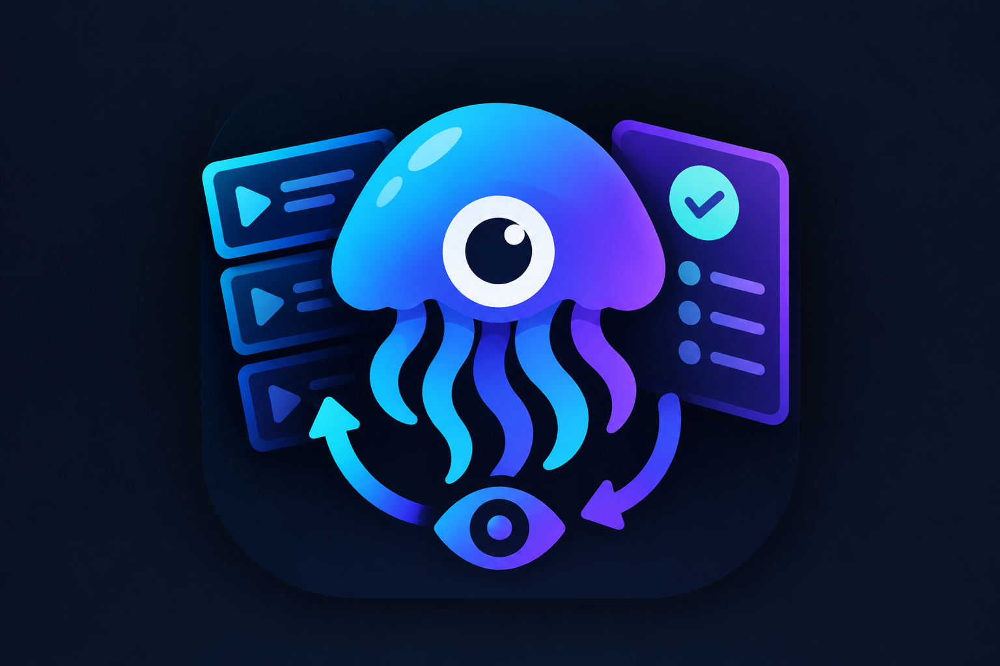

> **Unofficial personal project.** Not affiliated with Jellyfin and not security-audited. Use it at your own risk. The code was not reviewed by me.

<p align="center">
  
</p>

# JellyWatcher

**All your watchlists in one place, next to your Jellyfin library.**

Paste a list link from Trakt, Letterboxd, IMDb, TMDb, MyAnimeList, AniList or MDBList, or upload an
export. JellyWatcher shows every list as a timeline, tells you what's already in **Jellyfin**, what
you've watched and what's next, and requests the rest through **Seerr**. It runs as one Docker
container; everything is set up in the browser.

## Install

You need Docker with Compose (v2.24 or newer). Copy this block into a terminal:

```bash
mkdir -p jellywatcher/data && cd jellywatcher
curl -fsSLO https://raw.githubusercontent.com/TIGamingTV/JellyWatcher/main/compose.yaml
sudo chown 1000:1000 data
docker compose up -d
docker compose logs jellywatcher | grep "setup code"
```

Then open **http://\<your-server\>:8484**, enter the setup code from the last command, and sign in
with your Jellyfin administrator account. Done.

<details>
<summary><b>Prefer to paste the <code>compose.yaml</code> yourself</b> (Portainer, Dockge, …)</summary>

Save this as `compose.yaml` in an empty folder, create a `data` folder next to it owned by uid 1000
(`mkdir data && sudo chown 1000:1000 data`), and start it with `docker compose up -d`.

```yaml
services:
  jellywatcher:
    image: ghcr.io/tigamingtv/jellywatcher:latest
    container_name: jellywatcher
    restart: unless-stopped
    ports:
      - "8484:8484"
    volumes:
      - ./data:/data
```

The setup code is printed to the log: `docker compose logs jellywatcher | grep "setup code"`.
</details>

<details>
<summary><b>Without Compose</b> (<code>docker run</code>)</summary>

```bash
mkdir -p data && sudo chown 1000:1000 data
docker run -d --name jellywatcher --restart unless-stopped --init \
  -p 8484:8484 -v "$PWD/data:/data" -e TZ=UTC \
  --read-only --tmpfs /tmp --cap-drop ALL --security-opt no-new-privileges:true \
  ghcr.io/tigamingtv/jellywatcher:latest
docker logs jellywatcher | grep "setup code"
```
</details>

### First steps in the browser

1. **Setup:** enter the setup code, choose **Set Up with Jellyfin**, enter your Jellyfin URL and sign
   in as a Jellyfin administrator (password or Quick Connect). JellyWatcher creates its own Jellyfin
   API key.
2. **Integrations › Seerr:** enter the Seerr URL and API key (Seerr › Settings › General) to request
   titles. TMDb and Trakt are optional; see the table below.
3. **Watchlists › Add List:** paste a list link, or pick a source to upload an export.

Use the address the **container** can reach for server URLs: a container name on a shared Docker
network (`http://jellyfin:8096`), or a LAN address (`http://192.168.1.10:8096`).

### Update

```bash
docker compose pull && docker compose up -d
```

The database is backed up to `data/backups/` and migrated automatically on start.

## Features

- **Lists from everywhere:** paste a link and the list keeps its order and syncs on its own, or
  upload an export. Create your own lists too, or duplicate any list into an editable copy.
- **Timelines:** every movie, show, season and episode in order, with the total watch time counting
  down as you watch. Click a show or season to unfold its episodes by season, each with its title,
  year and runtime and its own Watched and Skip buttons.
- **Your order:** drag entries around, or **Auto Sort** a list into release order (or newest first,
  title, runtime). Your order survives syncs and can be reset.
- **Up Next:** the next entry of every list on Home, with **Watch**, **Request**, **Watched** and
  **Skip**. Timelines have a **Request** button on every entry that can be requested.
- **Watched and Not Watching:** mark movies, shows, seasons or episodes as watched with a date, or
  skip what you don't want to see so Up Next moves on. Jellyfin progress is picked up automatically
  and stays even after a file is deleted.
- **Requests through Seerr** as your own Seerr user (its permissions and quotas apply), with season
  picking for shows and duplicate protection.
- **Exact matching:** by TMDb, IMDb and TVDB ids (anime included), fuzzy title matching otherwise,
  and a review queue for anything uncertain. Your decisions are remembered.
- **Multi-user:** everyone signs in with their Jellyfin account (password or Quick Connect); lists
  are private per person.
- **Inside Jellyfin (optional):** the [Jellyfin plugin](docs/jellyfin-plugin.md) adds a Watchlists
  page to Jellyfin's menu with your lists, their timelines, and Play, Request, Not Watching and
  Watched on every entry. It can also keep any list in Jellyfin as a **collection** or a **private
  playlist** in your order, so it shows up in every Jellyfin app, including Infuse.
- **Homelab-friendly:** one container, SQLite with automatic backups, non-root and read-only,
  encrypted credentials, health check, optional webhooks. Works on phones, tablets and desktops.

## Supported sources

| Source | Add by link | Upload a file | Notes |
| --- | --- | --- | --- |
| **Trakt** | Public lists and watchlists | — | Your own lists after signing in with Trakt. Needs a free Trakt API app, added once by an admin. |
| **Letterboxd** | Public lists and watchlists | Export ZIP or list CSV | Optional RSS diary. Links read the public page (Letterboxd has no API for personal projects). |
| **IMDb** | Public lists | CSV export | Watchlists are private on IMDb: use the CSV. |
| **TMDb** | Public lists | CSV with TMDb IDs | Links need the TMDb token in Integrations. |
| **MyAnimeList** | Public anime lists | XML export | Later seasons become seasons of the show. |
| **AniList** | Public anime lists | MyAnimeList-format XML | Planning by default, or any list by name. |
| **Simkl** | — | CSV, JSON or ZIP export | Simkl shares lists only with signed-in apps. |
| **MDBList** | Public lists | CSV export | Static and dynamic lists. |

Example links: `https://letterboxd.com/name/list/list-name/`, `https://www.imdb.com/list/ls020816781/`,
`https://trakt.tv/users/name/lists/list-name`, `https://www.themoviedb.org/list/1`,
`https://myanimelist.net/animelist/name?status=6`, `https://anilist.co/user/name/animelist/Planning`,
`https://mdblist.com/lists/name/list-name`.

Server connections:

| Service | Needed? | What you enter |
| --- | --- | --- |
| **Jellyfin** | Recommended | Created during setup (URL + your admin sign-in). |
| **Seerr** | For requests | URL + API key. |
| **TMDb** | Optional | API Read Access Token. Without it, Seerr's TMDb access is used; TMDb list links need it. |
| **Trakt** | For Trakt lists | Client ID + Secret of a free app from trakt.tv/oauth/applications. |

Details and verified limits per service: [docs/integration-matrix.md](docs/integration-matrix.md).

## Documentation

| Document | Content |
| --- | --- |
| [Setup](docs/setup.md) | Installation, first run, every service, environment variables. |
| [Operations](docs/operations.md) | Backups, upgrades, reverse proxy, networking, troubleshooting. |
| [Architecture](docs/architecture.md) | Design, data model, matching, security. |
| [Integration matrix](docs/integration-matrix.md) | What each service allows, and what is unsupported and why. |
| [Jellyfin plugin](docs/jellyfin-plugin.md) | The optional Watchlists page inside Jellyfin: install, security, limits. |

## Development

```bash
npm install
npm run dev      # API on :8484 + UI on :5173
npm test         # unit and end-to-end tests against mocked services
npm run build
```

Releases: set `version` in `package.json` and push a matching tag (`git tag v1.0.0 && git push origin
v1.0.0`). The [release workflow](.github/workflows/release.yml) tests, publishes the multi-arch image
to GHCR, creates the GitHub release with the Jellyfin plugin zip and adds the plugin version to
[`jellyfin-plugin/manifest.json`](jellyfin-plugin/manifest.json). The plugin version is the
JellyWatcher version plus `.0` (set `<Version>` in the plugin's `.csproj`; CI checks they match).

## Attribution

This product uses the TMDB API but is not endorsed or certified by TMDB. JellyWatcher uses Trakt but
is not endorsed or certified by Trakt. Anime ids come from the community-maintained
[Fribb/anime-lists](https://github.com/Fribb/anime-lists). JellyWatcher is not affiliated with
Jellyfin, Seerr, Letterboxd, IMDb, MyAnimeList, AniList, Simkl or MDBList. Data from these services
is for personal, non-commercial use under their terms.

## License

GPL-3.0-or-later. See [LICENSE](LICENSE).
